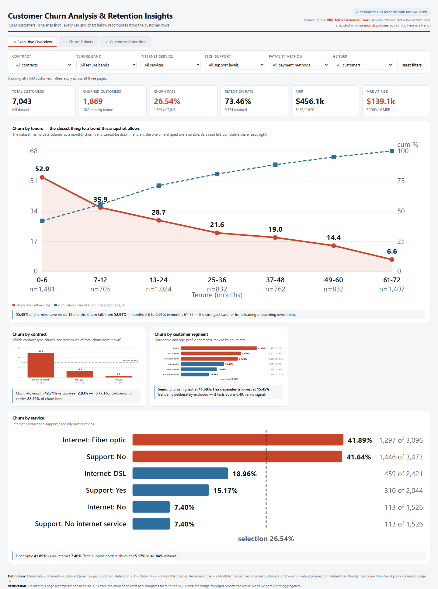

# Customer Churn Analysis & Retention Insights

[](https://www.python.org/)
[](sql/)
[](powerbi/)
[](LICENSE)

**Churn is a contract problem before it is anything else.** 7,043 customers · **26.54% churn** ·
**$139,130.85 of MRR** exposed every month · **833 customers** carry **31.67%** of all churn.

[](powerbi/customer_churn_dashboard.html)

*Executive Overview — page 1 of 3 in the [interactive dashboard](powerbi/customer_churn_dashboard.html).
Open it in any browser: one self-contained HTML file, no server, CDN, licence or network call.*

> **Reviewing this for a role?** Start with the dashboard, then read
> [`sql/04_retention_insights.sql`](sql/04_retention_insights.sql) for the tiering logic and
> [`reports/KPI_DEFINITIONS.md`](reports/KPI_DEFINITIONS.md) for the metric contracts. Every figure in
> this README is reproducible from the committed data and checked by
> [CI](.github/workflows/verify.yml).

**Jump to:** [Business objective](#business-objective) · [Analysis](#what-we-analyzed) ·
[Dashboard](#power-bi-dashboard--3-pages) · [Key findings](#key-findings) ·
[Repository structure](#repository-structure) · [How to run](#how-to-run) ·
[Verification](#verification) · [Limitations](#limitations) · [License](#license)

| | |
|---|---|
| **Churn rate** | **26.54%** (1,869 of 7,043) |
| **Retention rate** | 73.46% (5,174 retained) |
| **MRR on churned accounts** | **$139,130.85** — 30.50% of all MRR |
| **Annualised exposure** | $1,669,570.20 (run-rate, not realised loss) |
| **Best single predictor** | Contract type — 42.71% month-to-month vs 2.83% two-year |

**Tools**

```
Python  →  Pandas · NumPy · Matplotlib · Seaborn · scikit-learn
SQL     →  Data exploration · Aggregations · CASE statements · CTEs · Window functions
Power BI→  Interactive 3-page churn dashboard (model kit + rendered equivalent)
GitHub  →  Documentation + project files
```

---

## Business objective

> "Why are customers leaving, which customer segments have the highest churn risk, and what actions
> can the company take to improve customer retention?"

Every analysis below answers a decision, not a curiosity. The project does not stop at *"month-to-month
customers churn more"* — it quantifies who they are, what they are worth, and what to do first.

---

## What we analyzed

### 1. Overall customer health

| Metric | Value |
|---|---|
| Total customers | 7,043 |
| Churned customers | 1,869 |
| Active (retained) customers | 5,174 |
| Churn rate | **26.54%** (95% Wilson CI 25.52% – 27.58%) |
| Retention rate | 73.46% |
| Average tenure | 32.37 months (churners: 17.98 · retained: 37.57) |
| Average monthly charges | $64.76 (churners: $74.44 · retained: $61.27) |
| Total MRR | $456,116.60 |

### 2. Churn by customer segment

| Dimension | Highest-churn level | Lowest-churn level |
|---|---|---|
| Contract type | Month-to-month **42.71%** | Two year **2.83%** |
| Tenure | 0-6 months **52.94%** | 61-72 months **6.61%** |
| Monthly charges | $70-89 band **37.95%** | < $30 **9.80%** |
| Payment method | Electronic check **45.29%** | Credit card auto **15.24%** |
| Internet service | Fiber optic **41.89%** | No internet **7.40%** |
| Tech support | No **41.64%** | Yes **15.17%** |
| Online security | No **41.77%** | Yes **14.61%** |
| Age profile | Senior **41.68%** | Non-senior **23.61%** |
| Household | No partner **32.96%** | Has dependents **15.45%** |
| Gender | Female **26.92%** | Male **26.16%** — *p = 0.487, no signal* |

### 3. Churn drivers — the questions, answered

| Question | Answer | Evidence |
|---|---|---|
| Do short-tenure customers churn more? | **Yes, sharply.** 55.48% of all churners leave inside 12 months (41.95% inside six). | Retention curve, notebook §5 |
| Which contract type has the highest churn? | **Month-to-month, 42.71%** — 15.1x the two-year rate, and 88.55% of all churn. | Cramér's V 0.410, the strongest association in the data |
| Does higher monthly spending correlate with churn? | **Yes univariately, but it is confounded.** The $70-89 band churns at 37.95% vs 9.80% under $30 — fiber customers pay more *and* churn more, so price is partly a product proxy. | Notebook §6, §9 |
| Which payment method has the highest churn? | **Electronic check, 45.29%** vs 15-17% on automatic billing. It is the *mode* of payment, not the instrument (mailed check is only 19.11%). | `v_churn_by_payment` |
| Which segments are most vulnerable? | Month-to-month, first year, fiber, no tech support: **833 customers at 71.07%** — 31.67% of all churn from 11.83% of the base. | `v_high_risk_segments` |
| Does customer service usage relate to churn? | **Yes.** Tech-support holders churn at 15.17% vs 41.64% without; security holders 14.61% vs 41.77%. | `v_churn_by_service` |
| Which services have better retention? | Bundle depth: 5.29% churn at 7 add-ons vs 20.76% at zero — but the curve is U-shaped (peaks at 37.72% with 2), so depth helps above 2, not uniformly. | `03_customer_segmentation.sql` BQ11 |

**Driver ranking (Cramér's V, computed in the dashboard):** Contract 0.410 · Tenure 0.366 ·
Online security 0.347 · Tech support 0.343 · Internet service 0.322 · Payment method 0.303 ·
Charge band 0.246 · Dependents 0.164 · Senior 0.150 · Partner 0.150 · **Gender 0.009**.

### 4. Retention opportunities

Where the analysis becomes a plan. Tiers are **derived from a points scorecard**, not invented:

> Score (0–14) = month-to-month **3** · tenure ≤6m **3** / ≤12m **2** / ≤24m **1** · fiber **2** ·
> no tech support **2** · electronic check **2** · no online security **1** · senior **1**.
> Cut-offs sit where the observed churn rate steps up: **≥8 HIGH, 5–7 MEDIUM, ≤4 LOW.**

| Tier | Customers | Churn rate | Multiple | % of all churners | MRR lost | ARR exposure |
|---|---|---|---|---|---|---|
| **HIGH** | 2,684 (38.1%) | **53.43%** | 2.01x | 76.73% | $110,507.10 | $1,326,085.20 |
| **MEDIUM** | 1,480 (21.0%) | 19.80% | 0.75x | 15.68% | $18,084.15 | $217,009.80 |
| **LOW** | 2,879 (40.9%) | 4.93% | 0.19x | 7.60% | $10,539.60 | $126,475.20 |

The scorecard is monotone across all 15 score values (1.74% at 0 points → 78.26% at 14), which is what
makes the tiering defensible rather than decorative. **2,962 customers (42.1% of the base) hold 80% of
all churn** — that is the size of the retention list.

---

## Power BI dashboard — 3 pages

| Page | Focus | Screenshot |
|---|---|---|
| **1 · Executive Overview** | Total customers, churned, churn rate, retention rate · churn by tenure, contract, segment, service | `screenshots/executive_dashboard.png` |
| **2 · Churn Drivers** | Attribute strength (Cramér's V) ranked, then contract, tenure, charges, payment, support, bundle depth | `screenshots/churn_drivers.png` |
| **3 · Customer Retention** | HIGH / MEDIUM / LOW tiers, priority action list with owner and success metric, revenue exposure, Pareto | `screenshots/retention_analysis.png` |

**Slicers (all three pages):** Gender · Contract · Tenure band · Payment method · Internet service
(+ Tech support). Every KPI, chart and tier recomputes on selection.

**Three honest notes about this dashboard:**

1. **There is no "Churn Trend" page element.** The dataset has no date or month column, so a trend
   cannot be drawn. Page 1 shows churn across **tenure** — the only time-shaped axis in the data — and
   says so on the card. Fabricating a monthly trend from a single snapshot would be a defect.
2. **The `.pbix` is not in this repo, deliberately.** A `.pbix` is a proprietary binary that cannot be
   generated from text. `powerbi/` ships what is portable and verifiable: the star-schema CSVs, a
   30-measure DAX file with expected values, and a build guide containing the exact figures to check
   after wiring the model.
3. **`powerbi/customer_churn_dashboard.html` is a rendered equivalent, not the Power BI file.** It is
   self-contained, works offline, and is what the three screenshots were taken from.

**Live demo.** The root `index.html` redirects to the dashboard, so GitHub Pages
(Settings → Pages → Deploy from a branch → `main` / root) publishes it at
`https://<username>.github.io/customer-churn-analysis/` with no build step.

---

## Key findings

1. **Churn is a contract problem before it is anything else.** Month-to-month 42.71% vs two-year 2.83%
   — 15.1x — and month-to-month is 55.02% of the base but 88.55% of all churn.
2. **The first year decides the relationship.** 52.94% churn in months 0-6, falling monotonically to
   6.61% by months 61-72. Two-year contracts show **zero churn** through month 24 (0 of 158).
3. **One dense cell holds a third of the problem.** 833 customers at 71.07% churn = 31.67% of all churn,
   $67,629.90 of segment MRR, $48,489.95 already lost.
4. **Support and security behave like retention products** — 15.17% vs 41.64% and 14.61% vs 41.77%.
5. **Payment friction is real:** electronic check 45.29% vs 15.24% credit-card automatic.
6. **Demographics are mostly noise.** Gender p = 0.487, Cramér's V 0.009. Senior status is a genuine but
   weaker signal (41.68% vs 23.61%) and is largely inherited from product mix.
7. **Churn is skewed toward higher-value accounts:** churners paid $13.18/month more than those who stayed.

---

## What the dataset could and could not supply

The brief asked for churn by **age, gender, location, contract, tenure, payment method, internet/service
type, monthly charges, total charges**, and by **customer service usage**. Six of those nine exist in
full; three do not, and no amount of analysis can conjure them:

| Requested | Status | What was done instead |
|---|---|---|
| Age | ⚠ **Partial** — only `SeniorCitizen` (0/1). No age in years. | Senior vs non-senior analyzed: 41.68% vs 23.61% |
| Gender | ✅ Available | Analyzed — no signal (p = 0.487) |
| **Location** | ❌ **Absent** — no country, region, city or ZIP column | Reported as unavailable; a geographic cut would require an external join keyed on `customerID` that does not exist |
| Contract · Tenure · Payment · Internet/service · Monthly charges · Total charges | ✅ All available | Fully analyzed |
| Customer service usage | ⚠ **Partial** — `TechSupport` subscription (Yes/No), no ticket counts, call volume or resolution data | Used the subscription as the proxy: 15.17% vs 41.64% |

This table is in the README because a reviewer will ask, and inventing an "age band" or a "region"
column would have invalidated every downstream number.

---

## Repository structure

```
customer-churn-analysis/
│
├── data/
│   ├── raw/
│   │   └── customer_churn.csv              # 7,043 × 21, untouched
│   └── processed/
│       ├── customer_churn_cleaned.csv      # typed, banded, flagged
│       └── customer_churn_scored.csv       # + model scores and risk tier
│
├── python/
│   └── customer_churn_eda.ipynb            # executed: 14 code cells, 8 charts, 0 errors
│
├── sql/
│   ├── 01_data_exploration.sql             # views + 10-check integrity gate + profiling
│   ├── 02_churn_analysis.sql               # BQ1-BQ8 (window functions, Wilson CI)
│   ├── 03_customer_segmentation.sql        # BQ9-BQ15 (NTILE deciles, ranked cells)
│   └── 04_retention_insights.sql           # BQ16-BQ22 (tiers, Pareto, action table)
│
├── powerbi/
│   ├── customer_churn_dashboard.html       # interactive 3-page dashboard (offline)
│   ├── POWERBI_BUILD_GUIDE.md              # model wiring + verification values
│   ├── dax_measures.dax                    # 30 measures, folder-grouped
│   └── model/                              # star schema for import
│       ├── fact_churn.csv                  # 7,043 × 17
│       ├── dim_customer.csv                # 7,043 × 5
│       ├── dim_contract.csv                # 24 × 5
│       ├── dim_service.csv                 # 322 × 10
│       └── dim_tenure.csv                  # 7 × 2
│
├── screenshots/                            # rendered dashboard pages
│   ├── executive_dashboard.png
│   ├── churn_drivers.png
│   └── retention_analysis.png
│
├── reports/                                # evidence, not decoration
│   ├── KPI_DEFINITIONS.md                  # every metric + the gap between variants
│   ├── DATASET_DECISION.md                 # why this dataset
│   ├── ORIGINAL_FILE_AUDIT.md              # audit of the rejected source file
│   ├── _analysis_numbers.md                # raw executed output the docs were written from
│   ├── figures/                            # 8 EDA charts
│   └── sql/                                # every result set, rendered
│
├── build/                                  # reproducible, path-independent pipeline
│   ├── run_sql.py                          # rebuild warehouse + run 60 statements + gate
│   ├── export_bi.py                        # dashboard payload + Power BI star schema
│   ├── build_dashboard.py                  # inject payload into the HTML dashboard
│   ├── final_gate.py                       # independent pandas-vs-SQL reconciliation
│   └── verify_notebook.py                  # notebook output + 49-claim checker
│
├── db/churn.db                             # built by run_sql.py (gitignored, not committed)
├── index.html                              # GitHub Pages redirect to the dashboard
├── .github/workflows/verify.yml            # CI: rebuild and re-verify on every push
├── README.md
├── requirements.txt
├── LICENSE
└── .gitignore
```

**Screen these files:** `sql/01_data_exploration.sql` (definitions) and
`sql/04_retention_insights.sql` (the tiering logic). The SQL is the analysis; the notebook and
dashboard are presentations of it.

---

## How to run

Requires **Python 3.10+** (built and tested on 3.13). Node is optional — it is used only for a
syntax check of the dashboard's embedded JavaScript. Run these from the repository root.

```bash
python -m venv .venv && source .venv/bin/activate   # Windows: .venv\Scripts\activate
pip install -r requirements.txt

# 1. build the warehouse, run all 60 SQL statements, re-render reports/sql/
python build/run_sql.py          # prints statements_ok / errors, then GATE: ALL PASS

# 2. execute the notebook
jupyter nbconvert --to notebook --execute --inplace \
    --ExecutePreprocessor.timeout=900 python/customer_churn_eda.ipynb

# 3. rebuild the BI kit + dashboard
python build/export_bi.py
python build/build_dashboard.py

# 4. run the independent verification gates
python build/final_gate.py       # pandas vs SQL, tier monotonicity, artifact inventory
python build/verify_notebook.py  # 0 error cells, 8 charts, 49 numeric claims
```

Then open `powerbi/customer_churn_dashboard.html` — no server, no CDN, no network.

---

## Verification

Three independent implementations of the same metrics must agree. Current state, from the executed build:

| Metric | pandas (notebook) | SQL (views) | Dashboard (JS) | Match |
|---|---|---|---|---|
| Customers | 7,043 | 7,043 | 7,043 | ✓ |
| Churned | 1,869 | 1,869 | 1,869 | ✓ |
| Churn rate | 26.54% | 26.54% | 26.54% | ✓ |
| MRR total | $456,116.60 | $456,116.60 | $456,116.60 | ✓ |
| MRR churned | $139,130.85 | $139,130.85 | $139,130.85 | ✓ |
| HIGH tier churn rate | 53.43% | 53.43% | 53.43% | ✓ |

Automated gates that run on every build:

- **SQL runner** — 60 statements, 60 ok, **0 errors**; integrity gate **10/10 PASS**; tier monotonicity
  and partition checks PASS.
- **Notebook** — 0 error cells, 8 embedded charts, all **49** numeric claims in markdown found in
  executed stream output, and a live pandas-vs-SQL assertion including band-for-band charge-band equality.
- **Dashboard** — recomputes 5 headline KPIs from embedded rows at load and compares them to the SQL
  views (badge top-right); tier monotonicity re-checked on every filter change.

The same SQL and reconciliation checks run on every push in
[`.github/workflows/verify.yml`](.github/workflows/verify.yml) from a clean checkout: rebuild the
warehouse, re-run all 60 statements, regenerate the BI kit, then re-run both checks. A green run means
the committed data still produces every number in this README.

---

## Resume version

```
Customer Churn Analysis & Retention Insights | Python, SQL, Power BI

• Analyzed 7,043 customer records using SQL (CTEs, window functions, CASE logic) and Python
  (pandas, scikit-learn) to quantify a 26.54% churn rate and identify its drivers across contract
  type, tenure, service adoption and payment method.
• Built a 3-page interactive Power BI dashboard (executive overview, churn drivers, retention
  priorities) with working slicers, reconciling every headline figure against SQL views.
• Derived a data-gated retention tiering that concentrates 76.7% of all churn into 38.1% of the base,
  and translated it into a prioritized action list with owners and success metrics.
```

Numbers above are real outputs of this repository. Nothing is projected, and none of the
self-selection caveats below are glossed over.

---

## Limitations

1. **No time dimension.** Single snapshot — no trend, no seasonality, no cohort decay curve.
2. **Observational, not causal.** Contract, support and payment are customer choices, not assignments.
   The 42.71% vs 2.83% gap mixes a real incentive effect with self-selection.
3. **Revenue is a rate, not margin.** No cost-to-serve → no CLV, no true profitability per segment.
4. **No acquisition data** → no CAC, no payback, no retention ROI — only exposure.
5. **Model is a ranker.** Test AUC 0.8446 against a 73.46% majority baseline; a production threshold
   needs a cost matrix this data does not supply.
6. **Location, age-in-years and support-ticket volume are absent** (see the table above), so any
   claim about geography, age bands or service-call frequency is out of scope by construction.

---

## Provenance

Source is the public **IBM Telco Customer Churn** sample dataset — a widely used reference dataset, not
a live Telco extract. It is one snapshot with no date column. Treat all figures as the behaviour of
this sample, not as Telco's reported performance.

---

## License

MIT — see [LICENSE](LICENSE). The dataset is the public IBM Telco Customer Churn sample; credit and
licensing for the data remain with its original publisher.
